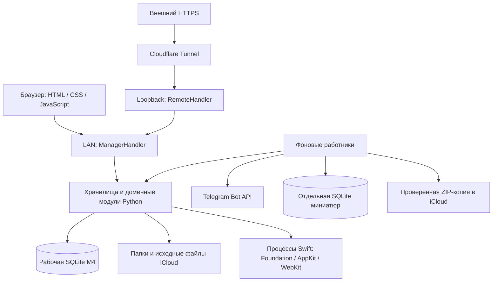

# Устройство приложения

Срез исходников от **13 ноября 2026 года**, документация **2.143.0**. Даты проверок рабочего M4 указаны в [журнале](CHANGELOG.md). Правила пользователя находятся в [структуре папок](folder-structure.md), [хранении](data-storage.md) и [операциях](operations.md). Полный перечень объявлений — в [справочнике кода](reference/README.md).

## Назначение и границы

Менеджер связывает существующий файловый архив «Зигзаг» с рабочими карточками, задачами, календарём, закупками, счетами и сверками. Сервер работает на Mac mini M4. Браузеры MacBook и телефона обращаются к нему по HTTP/HTTPS. Действие «Открыть на Mac» выполняется на машине сервера, поскольку именно Python запускает системную команду `open`.

Кнопка «Скачать» у эскизов и карточек CDR использует обычную ссылку на прежний файловый GET с `download=1`. `send_file` возвращает исходные байты как attachment с прежним именем; сохранением на устройстве пользователя управляет браузер. Дополнительного серверного запуска CorelDRAW, нового хранилища или API для скачивания нет.

Под эскизами заказа интерфейс показывает файлы непосредственных `# cutter`, `# freza` и `# docs` с вложениями. [read_folder](reference/python/server.md#symbol-read_folder) обходит эти ветки и передаёт порядок блоков в `orderFileFolders`. Файлы используют общий просмотрщик и комментарии. Каждая папка доступна на отдельной странице.

Обычные кнопки подпапок используют одну колонку CSS `.subfolders` при любой ширине. Специальные `.with-event-relevance`, `.work-section-buttons` и `.freza-task-grid` сохраняют прежние сетки событий/эскизов, цветных производственных разделов и заданий фрезеровки. Сетка файлов и меню независимы. Раскладка обычных папок не требует изменения DOM, API или хранилища.

Рабочие метаданные находятся в локальной SQLite. В iCloud остаются исходные вложения, папки заказов и опубликованные документы. Старые `!.txt`, `.order.json`, `.file-comments` нужны для первоначального переноса и совместимости, но не заменяют актуальную базу. Подробнее о сохранённых старых ветках — [реестр старого кода](legacy-code.md).

В репозитории нет отдельного сервера на Node.js, обязательной npm-сборки интерфейса, ORM или SPA-фреймворка. HTTP реализован стандартной библиотекой Python; интерфейс — обычными HTML/CSS/JavaScript. Swift используется для macOS-помощников и сохранённого приложения iPhone. C-обёртка обеспечивает запуск Python из приложения macOS с нужной идентичностью доступа к папкам.

## Состав системы

Стрелка `RemoteHandler → ManagerHandler` означает наследование и вызов проверенных унаследованных методов, а не проксирование на открытый LAN-порт. Защищённый слушатель создаётся отдельно. Настроенный маршрут Tunnel должен вести исключительно на `127.0.0.1:18767`.

## Запуск и конфигурация

[read_config](reference/python/server.md#symbol-read_config) читает `manager.ini` без интерполяции значений. Относительный `storage.root` разрешается относительно INI. `ZIGZAG_DATA_ROOT` переопределяет корень, `MANAGER_HOST` — интерфейс прослушивания. Порт берётся из INI; первый аргумент запуска `server.py` может задать порт для процесса. Текущий локальный INI указывает на `data/dev-documents` и `127.0.0.1:8766`.

Имя базы содержит первые 16 hex-символов SHA-256 строкового абсолютного корня. Переезд корня может выбрать другое имя базы, поэтому его нельзя считать обычным переименованием настройки. Конструктор [OrderStore.__init__](reference/python/orders.md#symbol-OrderStore.__init__) только задаёт пути и зависимости; открытие соединения выполняется отдельно.

[main](reference/python/server.md#symbol-main) удерживает блокировку установки до выхода Python. [serve](reference/python/server.md#symbol-serve) подготавливает схему, создаёт защитные снимки, запускает HTTP-слушатели, очереди публикации, супервизор миниатюр и Telegram Inbox. При SIGTERM слушатели закрываются, начатые запросы и переносы объектов завершаются, Inbox и синхронизация публикаций прекращают работу.

Установки задаёт `deploy.ini`. M4 использует `/Volumes/nvme2Tb/manager.zigzag` и LAN-порт 8765. MacBook использует отдельный каталог на внутреннем диске и loopback 8765. [Перенос](reference/python/scripts-handoff.md#symbol-main) координирует обе установки через SSH, используя блокировку деплоя и маркер остановки источника. На новую машину переезжают настройки, SQLite и защищённый внешний адрес. DNS и маршрут туннеля общие для обоих компьютеров.

## HTTP-слой

[ManagerHandler](reference/python/server.md#symbol-ManagerHandler) наследует `BaseHTTPRequestHandler`. `ThreadingHTTPServer` обслуживает запросы в потоках. `handle_get` разбирает путь и параметры и собирает JSON, статический ресурс, оригинал или превью. `do_GET` и `do_HEAD` используют общий путь обработки; HEAD не должен обходить проверку доступа. `do_POST` выбирает действие, проверяет размер/формат и вызывает узкую доменную операцию.

Маршруты не объявлены отдельным роутером: это ветки `if/elif` в обработчике. Поэтому [справочник API](reference/http-api.md) извлечён из реальных условий маршрутизации и содержит ссылки на соответствующие ветки. Найденная в тексте строка `/api/...` сама по себе ещё не считается маршрутом.

Для JSON-ошибок обычной записи обработчик различает 404 (цель исчезла), 409 (конфликт версии/идентичности), 400 (неприемлемый ввод), 500 (ошибка ОС), 503 (недоступная SQLite). У специальных потоковых обработчиков есть собственные ограничения и ответы; их нужно читать отдельно, а не переносить общие правила автоматически.

## Доменные слои

| Область | Основные модули | Ответственность |
| --- | --- | --- |
| Роли папок | `folder_structure.py` | Значение пути: клиент, объект, год, заказ, событие, производство, деньги, сверка |
| Заказ | `orders.py`, `order_document.py` | UUID/revision, статусы, суммы, заметка, задачи, блоки и первоначальный парсинг |
| Произвольная папка | `folder_notes.py`, `local_metadata.py` | Заметки, To-do, комментарии, импорт, история и публикации |
| Каталоги | `object_orders.py`, `work_order_list.py`, `hidden_orders.py` | Известные папки и строки списков без регистрации по факту показа |
| Активность | `client_activity.py`, `object_activity.py`, `event_relevance.py` | Разные уровни неактивности; состояние события не заменяет состояние клиента |
| Задачи | `order_todos.py`, `supplier_purchases.py` | Вложенные задачи и закупки из исходных заказов |
| Календарь | `order_calendar.py`, `order_deadlines.py`, `calendar_events.py`, `calendar_layout.py` | Сроки, текстовые события, свободные события и независимые отметки |
| Telegram | `telegram_calendar.py`, `calendar_delivery.py`, `calendar_todos.py`, `telegram_inbox.py`, `telegram_calendar_commands.py` | Получение, устойчивая команда, общий PNG и задачи |
| Деньги | `invoices.py`, `invoice_documents.py`, `invoice_discovery.py`, `reconciliations.py` | Счета, платежные планы, PDF, вложения и назначения сверкам |
| Файловые операции | `order_folders.py`, `order_creation.py`, `event_folders.py`, `folder_rename.py`, `file_trash.py`, `event_trash.py`, `object_years.py`, `object_move.py` | Создание, намерения, проверка содержимого при переносе и обратимые журналы |
| Просмотр | `icloud_access.py`, `thumbnail_cache.py`, `sketches.py`, `spreadsheet_preview.py`, `image_reports.py`, Swift | Ограниченное чтение и производные изображения/PDF |
| Эксплуатация | `recovery_backup.py`, `native_renderers.py`, `scripts/deploy*.py`, `remote_access.py` | Копии, сборка, релизы и защищённый вход |

Зависимость обычно направлена от HTTP к хранилищу, затем к чистым преобразователям блоков и файловым помощникам. Есть локальные импорты внутри методов: это реальные зависимости, а не признак неиспользуемого модуля. Самостоятельные скрипты отката дополнительно копируют часть модулей в журналы.

## Рабочая SQLite

[OrderStore.connect](reference/python/orders.md#symbol-OrderStore.connect) открывает соединение с timeout 15 секунд, включает WAL и `sqlite3.Row`, создаёт недостающие столбцы и схему метаданных. Контекст `with db` фиксирует успешную транзакцию и откатывает исключение; `finally` закрывает соединение. Создание схемы может происходить при обращении к адаптеру, поэтому даже логически читающий endpoint нельзя автоматически считать SQL-соединением `mode=ro`.

UUID отвечает за идентичность сущности, путь — за её расположение, revision — за версию. Эти понятия не взаимозаменяемы. Короткая частичная операция проверяет ожидаемую запись, меняет конкретные поля и повышает версию. `updated` изменяется только там, где это предусмотрено; например, отметка недели не должна переставлять строку по дате изменения заказа.

История метаданных записывается триггерами UPDATE/DELETE; отдельная история счетов ведётся их хранилищем. История сохраняет прошлое состояние, но не делает любое внешнее действие автоматически обратимым. Файловый перенос, отправка Telegram и запись SQLite имеют разные протоколы завершения.

[Справочник схемы](reference/sqlite-schema.md) показывает DDL и места изменения структуры. Он получен из исходников без открытия рабочей базы. Это описание потенциальной схемы версии кода, а не инвентаризация содержимого M4.

## Первоначальный импорт и выпуск

[MetadataStore.migrate](reference/python/local_metadata.md#symbol-MetadataStore.migrate) использует прежние парсеры, архивирует исходные байты и сохраняет результат в SQLite. Повторное открытие карточки не разрешает подменить позднюю правку базы внешним изменением `!.txt`. `metadata_imports` отличает завершённый импорт от ошибки. Неизвестный формат требует разбора, а не записи пустого состояния.

Выпуск документа идёт в другую сторону: неизменяемое содержимое сначала фиксируется в SQLite, затем очередь публикует копию в пользовательскую папку. Для печати это `metadata_publications`; счета и вложения имеют собственные сохранённые байты и признаки публикации. Ошибка iCloud оставляет повторяемое намерение, а не заставляет пользователя заново создавать документ.

## Браузер

В левой колонке показаны отмеченные недели поставщиков с комментариями начиная с текущей. Единственная отмеченная неделя без комментария видна рядом с названием заказа. Данные поступают из отдельного массива `/api/orders`. Редактор комментария и окно задач общие с календарём. В меню поставщика доступен один пункт «Смотри ту-ду». [renderSupplierSchedule](reference/javascript/static-app.md#symbol-renderSupplierSchedule)

Сводка закупок в разделе поставщика и внутри его заказа использует один компонент. Он получает `purchaseSupplierPath` вместе с карточкой и обновляет список из SQLite независимо от загрузки файлов. Кнопка копирования в сводке и кнопка Inbox используют общую функцию [copyText](reference/javascript/static-app.md#symbol-copyText).

[render](reference/javascript/static-invoice-products.md#symbol-render) показывает товары компактными строками в расширенной колонке и сортирует их по названию А–Я после группы и поиска; порядок SQLite не меняется. Копирование через [open](reference/javascript/static-invoice-products.md#symbol-open) получает новый UUID. [remove](reference/javascript/static-invoice-products.md#symbol-remove) подтверждает удаление; [write_catalog](reference/python/invoice_preferences.md#symbol-write_catalog) различает create/update/delete, сохраняет историю атомарно и по ней запрещает возврат удалённого UUID старой формой. Строки счетов используют независимые снимки товаров.

Панель товаров получает генератор UUID через `InvoiceProducts.init(addItem, newIdentity)`. Прежний [newIdentity](reference/javascript/static-invoices.md#symbol-newIdentity) использует `crypto.getRandomValues`, доступный и по обычному HTTP LAN; `crypto.randomUUID` в этом контексте отсутствует. Открытие формы новой группы/товара не требует HTTPS и не записывает данные до явного сохранения.

`static/invoice-products.js` управляет общей панелью плоских групп товаров слева от редактора счёта (на телефоне — над полями), а отдельная форма товара не участвует в автосохранении счёта. `static/settings.js` независимо загружает реквизиты и настройки пароля. [resource](reference/python/invoice_preferences.md#symbol-resource) обслуживает `/api/invoice-products` и `/api/invoice-seller`: версии, проверка формата, точные цены и история настроек сохраняются в SQLite. Редактор копирует товар в обычные позиции; изменение справочника не обновляет их задним числом. `InvoiceStore.create` копирует текущие реквизиты, в том числе при «На основе»; сохранённые счета используют собственный снимок.

[renderBrandCalendar](reference/javascript/static-app.md#symbol-renderBrandCalendar) вычисляет гражданскую дату Europe/Moscow, её понедельник и текущую ISO-неделю через прежний deadlineWeekInfo. Постоянный span с номером недели в шапке обновляется только при смене ключа даты, без замены DOM и запросов; функция вызывается при старте, в прежнем опросе видимой страницы и при focus/visibilitychange. Квадратик использует общий deadline-week/current и прежний цвет месяца; диапазон недели доступен через title/aria-label; отдельная дата в шапке не выводится. Выделение calendarToday задано только CSS, его обработчик навигации прежний.

Свободное календарное событие хранится в одной таблице calendar_events: day/week в period задают лишь привязку к дню или неделе. Контекстное меню меняет её через прежний CalendarEvents.move с явным target_period и тем же UUID/revision; это частичное обновление прежней строки, без создания новой сущности или изменения схемы. Общее представление по period размещает событие в дне либо колонке «На неделю».

Фильтр клиента в `static/bills.js` использует вычисленный `client_path` сводки для точного выбора без смешения одинаковых имён. Полный набор вариантов не зависит от текстового поиска, выбранный исчезнувший клиент не сбрасывается. Native select остаётся тем же DOM-элементом, изменения вариантов откладываются до ухода фокуса, чтобы не закрывать выбор при опросе. Имя в колонке также применяет фильтр; выбранное значение сохраняется при событиях редактора и переходах в памяти страницы.

`window.ManagerInvoices.openFromCatalog` связывает общий список с прежним редактором `static/invoices.js`: свежий счёт читается по пути/UUID, черновик открывается здесь же, выпущенный по явному `copy` создаёт новый «На основе». Вычисленный `edit_action` учитывает тип счёта и регистрацию владельца. Событие `manager-invoice-saved` после сохранения/создания/выпуска обновляет сводку; опрос не заменяет поля редактора, закрытие возвращает фокус по устойчивому ключу строки. Переход во время загрузки не открывает окно в другом контексте.

`static/bills.js` показывает отдельные таблицы общего раздела счетов и его входящих. Сводка `/api/invoice-catalog` читает метаданные SQLite без BLOB и файлового обхода, поиск и сортировка по всем шести колонкам работают в браузере; дата показана первой, исходный порядок — новые даты сверху. Выбор сортировки хранится в памяти страницы, неизменившиеся строки сохраняют DOM, а обновлённые — фокус и прокрутку. Входящие используют только непосредственные файлы уже открытой папки и прежний просмотрщик, не создавая счетов.

[Порядок подключения](../static/index.html) задаёт обычные script-теги. Общие переменные и функции `static/app.js` доступны последующим скриптам; это не ES-модули. `HomeCalendar`, `MoneyOverview`, `OrderSorting` и другие компоненты используют локальные замыкания и экспортируемые объекты. Отдельная страница скрытых заказов имеет свой скрипт.

Общий `state` хранит открытое представление, папку, заказы, фильтры, черновики и выполняемые операции. Фоновый ответ сервера не должен безусловно заменять сфокусированное поле или повышать его базовую revision поверх несохранённого ввода. За сохранение состояния отвечает конкретный компонент; общей библиотеки форм/реактивности нет.

Базовый опрос рабочих сводок идёт из SQLite; файлы перечисляются при явном открытии папки, обновлении соответствующего каталога или специально согласованном узком счётчике Inbox. Нельзя заменять такую сводку повторным рекурсивным обходом iCloud каждые пять секунд.

`HomeCalendar` хранит переключатель «Старые» только в памяти открытой страницы. Обычная сетка использует явные ключи недель и пропускает прошлые без актуальных невыполненных видимых событий; просмотр истории возвращает непрерывное прошлое и закрытые строки. `snapshotRange` и серверный `calendar_delivery.period` одинаково исключают такую предыдущую неделю, независимо от режима просмотра. Первая колонка группирует только обычные заказы под отдельными заголовками клиентов, различая точные пути; клиент показан обычным чёрным текстом, в подписи заказа после названия мелко показан объект. Поставщики идут перед всеми группами заказчиков отдельными строками без заголовков; мелкие заказы сохраняют плоский список синих ссылок в нижней левой области. Клон снимка убирает строки, добавленные историей, и их опустевшие заголовки; формат SQLite и API записей не меняется.

## Фоновые процессы

| Работник | Запуск и смысл |
| --- | --- |
| `metadata_worker` | Первоначальный импорт, переход связей, восстановление намерений создания и локальные снимки; событие обновления и минутный цикл |
| `order_sync_worker` | Повтор очередей хранилищ/документов с паузой 15 секунд |
| `order_todo_worker` | Каталог вложенных задач, событие явного обновления и цикл 5 минут |
| `client_activity_worker` | Индекс активности клиентов и объектов; в SQLite-режиме файловая синхронизация ограничена реализацией адаптера |
| `mobile_sync_worker` | Поток создаётся исторически, но сразу возвращается при `DATABASE_ONLY = True` |
| `telegram_inbox.worker` | Получение сообщений, курсор, задачи Inbox и выполнение запросов `/calendar` |
| `thumbnail_cache.supervise` | Контроль отдельного процесса миниатюр с низким приоритетом и его завершения |
| `recovery_backup.worker` | Ежедневная по Москве ZIP-копия, повтор после ошибки и состояние на главной |

Точные интервалы и точки ожидания доступны по ссылкам в [справочнике](reference/README.md). Частота получения сообщения Telegram не означает гарантированную доставку в реальном времени.

## Нативные помощники

[build](reference/python/native_renderers.md#symbol-build) разрешает реальные пути до компиляции, вычисляет хеш Swift-исходника и использует `data/native-renderers/<имя>-<хеш>`. Swift module cache — `data/swift-cache-v2`. Сборка идёт во временный каталог, готовый бинарный файл публикуется заменой только после успеха.

| Исходник | Задача |
| --- | --- |
| `icloud_read.swift` | Один согласованный Foundation-read с пределом размера; таймаут контролирует Python |
| `pdf_preview.swift` | Информация о PDF и изображение страницы через PDFKit |
| `thumbnail_preview.swift` | Производные миниатюры изображений/видео/документов |
| `image_report.swift` | PDF с выбранными изображениями и сохранёнными комментариями |
| `invoice_pdf.swift` | Печатная раскладка счёта/договора и извлечение текста PDF |
| `calendar_renderer.swift` | Изолированный WebKit без пользовательской браузерной сессии для `/calendar` |

Изменение только комментария Swift тоже меняет хеш исходника и вызовет новую сборку при следующем развёртывании. Документационный коммит поэтому не следует считать уже доставленным или проверенным на M4.

## Внешний вход

[handler_class](reference/python/remote_access.md#symbol-handler_class) создаёт подкласс обработчика для отдельного loopback-слушателя. Он проверяет Host, профиль, сессию и строгий Origin внешнего POST до передачи управления приложению. Пароль хранится как PBKDF2-SHA256 с 600000 итераций; секреты профиля находятся вне Git, SQLite, iCloud и документов.

Сессия подписана случайным ключом профиля. Cookie имеет `Secure`, `HttpOnly`, префикс `__Host-`, `SameSite=Lax`, срок до 12 часов либо до 30 дней с запоминанием. При истечении входа `static/remote-access.js` предлагает отдельную вкладку и сохраняет открытый черновик. Автоматического повтора записи после входа нет.

`Referrer-Policy: same-origin` сохраняет Origin обычного POST формы входа для строгой проверки обработчика. У `no-referrer` этот Origin становится null; такой запрос сервер отклоняет до проверки пароля. Политика same-origin также закрывает передачу Referer на другие сайты.

`static/settings.js` открывает диалог из шестерёнки справа от названия «Зигзаг», заменившей прежний значок обновления, независимо от опроса главной. Оба слушателя разделяют один `PasswordGate` и блокировку смены профиля. `/api/manager-settings` выдаёт короткий токен текущего профиля, `/api/manager-settings/password` проверяет его и Origin; внешний обработчик дополнительно требует сессию и текущий пароль, локальный допускает восстановление забытого. `PasswordGate.change_password` сохраняет закрытую копию и атомарно меняет профиль; другие подписи отзываются, текущий внешний сеанс переподписывается с прежними датами. Окно не сохраняет поля в браузерном хранилище и не повторяет POST после ошибки связи.

[Эксплуатационная проверка внешнего входа](operations.md#удалённый-доступ) от 4 ноября 2026 года подтвердила HTTPS и форму пароля на manager.actu.cc, защиту API/файлов и активный DNSSEC. Отдельный loopback-слушатель обслуживается прежним Cloudflare Tunnel.
