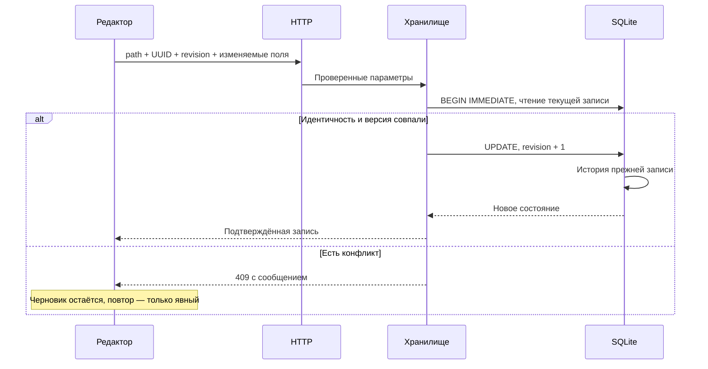

# Как проходят основные операции

Срез кода: **4 ноября 2026 года**. Сначала прочитай [устройство приложения](architecture.md). Здесь каждый сценарий связан с фактическими точками входа; подробные сигнатуры и вызовы — в [справочнике](reference/README.md).

## Открытие главной

1. Браузер получает `index.html`, CSS и локальные скрипты. `app.js` создаёт общий `state`, обработчики и переходы.
2. [showOrders](../static/app.js#L3696) открывает главную, [loadOrders](../static/app.js#L2037) получает `/api/orders`.
3. [listed_orders](../server.py#L969) читает зарегистрированные заказы, фильтрует неактивных клиентов и объекты, отделяет производство и архив, добавляет вложенные задачи, свободные события и планы платежей.
4. [OrderStore.record](../orders.py#L112) преобразует SQL-строку: JSON-блоки, статусы, вычисляемые суммы, сроки, календарные признаки и роль пути.
5. [renderOrders](../static/app.js#L3610) строит группы таблицы; [renderHomeCalendar](../static/app.js#L3023) передаёт календарные данные в `HomeCalendar`.
6. Отдельные компоненты обновляют Telegram Inbox, файловый счётчик и сводку денег. Каждая подсистема имеет собственные ограничения и состояние ошибки.

Обычный опрос главной не обходит документы iCloud. Первоначальный импорт и обновление каталога задач работают отдельно. Ошибка файлового обхода не должна превращаться в удаление рабочих записей.

## Открытие папки

[navigate](../static/app.js#L3751) получает `/api/folder` и применяет представление по роли. [read_folder](../server.py#L1175) проверяет путь и незавершённые переименования, определяет роль, собирает необходимые подпапки и разрешённые сведения о файлах.

У клиента — заметка и подпапки; у объекта — заметка, общий компонент списка его заказов и контейнеры; у самого заказа — карточка, задачи, события, счета и эскизы, без автоматической загрузки всех вложений. В событии или служебной папке доступны соответствующие документы. В сверке используется отдельное хранилище. Роль не определяется одной только глубиной пути: [классификатор](../folder_structure.py) учитывает служебные корни, числовые группы, годы и производство.

Дерево раскрывается лениво. Поиск дерева может потребовать обхода имён; это отдельная операция, а не скрытое действие опроса таблицы заказов.

## Сохранение карточки и конфликт

Название производственного статуса `done` — «Готово и оплачено». Интерфейс и новые текстовые карточки используют его; импорт прежнего «Готово» сохраняет тот же ключ. Переименование не выполняет запись в заказы и не меняет отдельный финансовый статус или суммы. На главной `done` по-прежнему скрыт, в объекте и «Скрытых заказах» доступен.

Основная форма: [saveCurrentStatus](../static/app.js#L1811) → `/api/order-save` → [OrderStore.save](../orders.py#L231). Частичные кнопки используют отдельные маршруты и методы. Сохранение всей карточки ради переключения одного флажка опасно: старое поле формы могло бы затереть более новую задачу, сумму или событие.

Проверка revision — оптимистическая блокировка, а не автоматическое объединение текстов. После 409 форма остаётся у пользователя; серверные данные и черновик нужно сравнить. Фоновая перезагрузка не даёт права автоматически повторить запрос с новой revision.

## Создание заказа

[createOrderFolder](../static/app.js#L1615) отправляет заполненную форму. [create](../order_folders.py#L76) проверяет клиентскую область, контейнер года и предлагаемое имя. [prepare](../order_creation.py#L42) фиксирует намерение с UUID до завершения набора файловых действий.

Файловый план создаёт папку заказа и пустые `# bills`/`# cdr`; затем регистрация связывает путь и тот же UUID с записью SQLite. После сбоя [recover](../order_creation.py#L136) и [retry_one](../order_creation.py#L154) могут завершить только собственные шаги, владение которыми доказывается журналом. Похожее название чужой папки не считается доказательством.

Создание сверки использует этот механизм намерения, но создаёт только папку и запись сверки: заказные служебные подпапки и регистрация `orders` ей не нужны.

## Вложенные задачи

Собственные To-do находятся в блоке карточки; вложенные карточки — в `folder_notes`. [OrderTodos.refresh](../order_todos.py#L112) обновляет `todo_catalog`, фиксирует отсутствующие пути только после полного успешного обхода и сохраняет ошибки. [OrderTodos.attach](../order_todos.py#L45) присоединяет готовую сводку к заказам без чтения файлов.

[OrderTodos.in_order](../order_todos.py#L93) возвращает задачи для страницы одного заказа. Выполненные сохраняются, но скрыты в обычной актуальной сводке. Обновление индекса не переносит задачи в родителя и не меняет их исходный текст.

## Закупка у поставщика

[SupplierPurchases.read](../supplier_purchases.py#L148) выбирает закупки из исходных заказов. У `etc` — только неназначенные строки; у поставщика — строки с соответствующим назначением. Выбор доступных кнопок опирается на сохранённые избранные разделы `# work`, при этом старые назначения не исчезают после снятия звезды.

Карандаш открывает [openEditor](../static/supplier-purchases.js#L91). Сохранение передаёт путь поставщика, путь/UUID/revision источника, индекс и исходный текст. [SupplierPurchases.edit](../supplier_purchases.py#L170) проверяет принадлежность, а [write_purchase_text](../order_document.py#L236) меняет только текст исходной строки с сохранением checkbox, назначений и переводов строк.

При изменении источника «Проверить изменения» перечитывает его без подмены черновика. Переставленная или исчезнувшая строка требует нового явного выбора; совпавший индекс не является идентичностью задачи.

## Три вида календарных записей

| Вид | Источник | Сохранение |
| --- | --- | --- |
| Событие заказа/поставщика | JSON-блоки `orders.extra_blocks` | Частичные методы `OrderStore` и преобразователи `order_calendar` |
| Свободное текстовое событие | `calendar_events` | `CalendarEvents` с UUID/revision и историей |
| План прихода/расхода | `invoices.data` | `InvoiceStore`, отдельные `_calendar_*` признаки |

[openCalendarEvent](../static/app.js#L3430) и контекстное меню сначала определяют вид записи. Текстовый редактор заказа не должен сохранять план платежа через API свободного события. Выполнение, актуальность, выезд и «Смотри ту-ду» независимы; деньги и статусы заказа не меняются от календарной галочки.

[visibleOrderWeeks](../static/home-calendar.js#L61) оставляет строку прошедшей недели только при актуальном невыполненном событии. Неизвестные тексты сохраняют доступность. В текущей и будущих неделях действуют прежние правила сроков. «Мелкий заказ» показывает ссылку в первой колонке выбранной недели, сохраняя события, но убирая его обычную строку. Ручной перенос оплаты влево меняет размещение, а не дату платежа.

Семь кнопок под стрелками дневного контекстного меню вычисляются от даты выбранного события в UTC как контейнере гражданской даты. Смещение 1–7 передаётся одним запросом в прежний API переноса соответствующего вида записи; сервер сохраняет прежние проверки версии, занятой даты и остальных отметок. Недельным записям эти кнопки не показываются.

`calendarRange` возвращает явный список ключей недель: текущая/будущие непрерывны, прошлые без открытых видимых дел пропускаются. Навигация и сохранение периода используют эти ключи, поэтому промежутки прошлого не возвращаются из-за более раннего открытого события. Переключатель «Старые» возвращает непрерывное прошлое и строки закрытых/снятых событий без изменения SQLite; опрос сохраняет режим.

Неделя определяется понедельником Москвы. JavaScript использует UTC-объект как контейнер гражданской даты; это не перенос делового дня в часовой пояс компьютера. [Подробный разбор дат](language/javascript.md).

## Общий PNG и `/calendar`

Кнопка использует [capture](../static/calendar-snapshot.js#L20), общий DOM-рендер и `/api/calendar-telegram`. Серверная команда работает без открытого пользовательского браузера: [send_calendar_command](../server.py#L987) → [period](../calendar_delivery.py#L32) → [render](../calendar_delivery.py#L96) → WebKit → [send](../telegram_calendar.py#L217).

Граница — воскресенье следующей недели Москвы. Предыдущая неделя добавляется только при видимом актуальном невыполненном событии заказа/поставщика, свободной записи или плане. Сроки и мелкие ссылки сами её не удерживают. Переключатель «Старые» влияет только на живую сетку; клон PNG отбрасывает добавленные просмотром истории закрытые строки заказов. Живая сетка показывает две недели; снимок может содержать три. Снимок и тексты [digest](../calendar_todos.py#L8) должны использовать один и тот же период и видимость.

Для команды [ingest](../telegram_inbox.py#L102) в одной SQL-транзакции сохраняет запрос и getUpdates cursor. [enqueue](../telegram_calendar_commands.py#L27) связывает UUID с ботом, личным чатом и message_id; повтор доставки не создаёт новую отправку. [process](../telegram_calendar_commands.py#L50) переводит `pending → sending → complete/failed`. Незавершённое `sending` после перезапуска автоматически не отправляется снова.

Одна `SEND_LOCK` сериализует кнопку и команду. Сначала подтверждённый `sendDocument`, затем части `sendMessage`. Каждый ответ проверяется; ошибка после PNG сообщает частичный результат. Идемпотентность приёма команды не равна гарантии exactly-once внешнего Bot API: после обрыва нельзя безопасно повторять неопределённый результат.

## Inbox Telegram и файловая папка Inbox

Это разные источники. [poll](../telegram_inbox.py#L154) принимает сообщения бота, [ingest](../telegram_inbox.py#L102) делит допустимый человеческий текст по непустым строкам и фиксирует задачи с курсором без дублей. `/calendar` распознаётся отдельно в настроенном личном чате.

[snapshot](../inbox_folder.py#L9) только считает непосредственные видимые обычные файлы `#inbox`/`# inbox`, исключая ссылки. Неоднозначность и ошибка обозначают недоступность счётчика. Кнопка вызывает прежний `/api/open` с точным путём; файл не становится задачей Telegram и папка автоматически не создаётся.

## Счёт, выпуск, копия

[InvoiceStore.create](../invoices.py#L832) создаёт черновик; `save` проверяет версию и данные, `issue` присваивает предусмотренный номер и фиксирует PDF. Байты выпущенного документа сохраняются в SQLite. Повторять выпуск как обычное обновление полей нельзя: для нового содержания создаётся документ «На основе».

Публикация в `# bills` повторяется по устойчивому состоянию. Имя существующего оригинала не занимается молча. Внешний PDF может загружаться как BLOB либо явно прикрепляться из `# bills` через [attach](../invoice_discovery.py#L85): отпечаток до/после чтения, предел размера, корректный PDF, защита от дубликата по точным байтам и устойчивой идентичности.

[upload](../invoice_documents.py#L138) обслуживает вложения счёта; это отдельные документы с собственной историей/публикацией, а не замена выпущенного PDF. План платежа в календаре не означает фактическое изменение `paid` заказа.

## Сверки

[Reconciliations.catalog](../reconciliations.py#L189) возвращает известные сверки для списка; явное `open` выполняет безопасный переход старых карточек. В `reconciliation_invoices` UUID счёта — первичный ключ, поэтому одновременно назначить его двум сверкам нельзя. `assign` проверяет актуальный контекст и меняет назначение, не удаляя счёт.

Переименование сохраняет UUID сверки, назначения и историю, но меняет путь/revision. Пустая заметка старого импорта считается безопасным исключением только при строгом наборе признаков; проверка находится в [untouched_empty_note](../reconciliations.py#L97).

## Переименование и корзина

Файловое действие не помещается целиком в SQL-транзакцию. Поэтому [Plan](../folder_layout.py#L78) хранит план, отпечатки, журнал с flush/fsync и обратные операции; перенос не перезаписывает назначение. Специализированные rename-модули меняют связанные ключи SQLite, а незавершённый журнал блокирует обычные записи в затронутую область.

[resume](../file_trash.py#L261) умеет завершить доказанный подготовленный перенос. Самостоятельные `.restore.py` и копии модулей в журналах должны работать без текущего HTTP-сервера. Удалять такие «дубли» как неиспользуемые файлы нельзя. [restore](../event_trash.py#L135) дополнительно возвращает состояние папки события и её базовые связи.

## Просмотр документа

Просмотр оригинала начинается с проверки пути и типа. iCloud-чтение проходит через [read_bytes](../icloud_access.py#L55), с пределом и таймаутом. PDFKit и ImageIO создают производные представления, оригинал не переписывается. Кеши привязаны к версии исходника.

Для Excel браузер запускает Worker: [open](../static/spreadsheet-preview.js#L14) → `/api/spreadsheet` → `spreadsheet-worker.js` → локальный SheetJS → ограниченная порция ячеек. Макросы и формулы не выполняются. Сохранённые результаты формул можно показать; отсутствие результата не даёт права вычислять произвольный код книги.

## Резервная копия и релиз

Локальный `MetadataStore.backup` использует SQLite backup API и `quick_check`, затем публикует снимок. [create](../recovery_backup.py#L139) собирает отдельный ZIP для iCloud: база, исходники, настройки, манифест и инструкция восстановления; не дублирует все вложения. Запись ZIP и его проверка не доказывают завершённую доставку iCloud на другое устройство.

[main](../scripts/deploy.py#L54) фиксирует состав исходников, запускает тесты, проверяет неизменность состава, формирует пакет с хешами и отправляет его SSH-помощнику. [deploy](../scripts/deploy_remote.py#L367) проверяет совместимость актуальной базы, готовит Swift-помощники и новый релиз, переключает код с контролем здоровья. База общая и не заменяется пакетом. Откат кода сохраняет текущие данные, но блокируется при неподдерживаемых контрактах.
