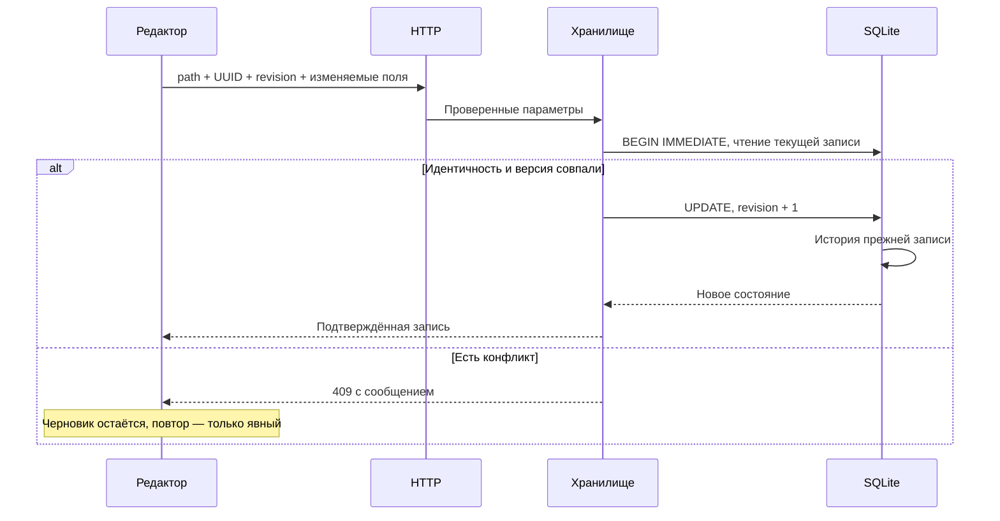

# Как проходят основные операции

Срез кода от **12 ноября 2026 года**. [Устройство приложения](architecture.md) описывает компоненты, а [справочник](reference/README.md) содержит их сигнатуры и вызовы.

## Открытие главной

1. Браузер получает `index.html`, CSS и локальные скрипты. `app.js` создаёт общий `state`, обработчики и переходы.
2. [showOrders](reference/javascript/static-app.md#symbol-showOrders) открывает главную, [loadOrders](reference/javascript/static-app.md#symbol-loadOrders) получает `/api/orders`.
3. [listed_orders](reference/python/server.md#symbol-listed_orders) читает зарегистрированные заказы, фильтрует неактивных клиентов и объекты, отделяет производство и архив, добавляет вложенные задачи, свободные события и планы платежей.
4. [OrderStore.record](reference/python/orders.md#symbol-OrderStore.record) преобразует SQL-строку: JSON-блоки, статусы, вычисляемые суммы, сроки, календарные признаки и роль пути.
5. [renderOrders](reference/javascript/static-app.md#symbol-renderOrders) строит группы таблицы в порядке из [productionStatusGroups](reference/javascript/static-app.md#symbol-productionStatusGroups). Третья группа собирает заказы с `done_unpaid`. На главной [renderOrderListMoney](reference/javascript/static-app.md#symbol-renderOrderListMoney) показывает `amount − paid` после комментария и выводит `debt` с подписью «Остаток =» на второй строке. Если указана только сумма, оплата отображается как `0`, а остаток равен `amount`. При отсутствии суммы и оплаты ячейка пустая. [renderHomeCalendar](reference/javascript/static-app.md#symbol-renderHomeCalendar) передаёт календарные данные в `HomeCalendar`.
6. Отдельные компоненты обновляют Telegram Inbox, файловый счётчик и сводку денег. Каждая подсистема имеет собственные ограничения и состояние ошибки.

Обычный опрос главной не обходит документы iCloud. Первоначальный импорт и обновление каталога задач работают отдельно. Ошибка файлового обхода не должна превращаться в удаление рабочих записей.

Цвет клиента редактируется из его карточки. [read](reference/python/client_colors.md#symbol-read) возвращает сохранённый RGB и версию, [save](reference/python/client_colors.md#symbol-save) проверяет путь, формат и версию в транзакции с историей. После ответа плашки в открытой вкладке меняются сразу. Другие вкладки получают цвета с очередной сводкой. Переименование клиента перепривязывает цвет вместе с метаданными, перенос объекта меняет его принадлежность к клиенту в сохранённых путях.

## Открытие папки

[navigate](reference/javascript/static-app.md#symbol-navigate) получает `/api/folder` и применяет представление по роли. [read_folder](reference/python/server.md#symbol-read_folder) проверяет путь и незавершённые переименования, определяет роль, собирает необходимые подпапки и разрешённые сведения о файлах.

У клиента — заметка и подпапки; у объекта — заметка, общий компонент списка его заказов и контейнеры; у самого заказа — карточка, задачи, события, счета, эскизы и файлы непосредственных `# cutter`, `# freza` и `# docs`. В событии или служебной папке доступны соответствующие документы. В сверке используется отдельное хранилище. Роль не определяется одной только глубиной пути: [классификатор](../folder_structure.py) учитывает служебные корни, числовые группы, годы и производство.

Дерево раскрывается лениво. Поиск дерева может потребовать обхода имён; это отдельная операция, а не скрытое действие опроса таблицы заказов.

## Файлы cutter, freza и docs на странице заказа

[read_folder](reference/python/server.md#symbol-read_folder) выбирает непосредственные `# cutter`, `# freza` и `# docs` заказа, а для заказа клиента также `# pvc` и `# alum`. `orderFileFolders` содержит существующие папки в этом порядке, `files` — файлы с путями относительно заказа. `filesScope=events` скрывает общий список и загрузку в корень. [renderOrderFileFolders](reference/javascript/static-app.md#symbol-renderOrderFileFolders) выводит блоки после эскизов, сгруппированные карточки и переходы в папки. Файл открывает [showPreview](reference/javascript/static-app.md#symbol-showPreview), комментарии обновляют видимую карточку.

Переключатели в подвале клиентского заказа используют [service_folders](reference/python/order_folders.md#symbol-service_folders) через GET и POST `/api/order-service-folders`. Опрос читает непосредственные имена и проверяет наличие первой записи в каждой управляемой папке. POST сверяет идентичность заказа и снимок выбранной папки, создаёт её через `mkdir` или удаляет через `rmdir` относительно открытого дескриптора заказа. Если запись появилась после проверки, файловая система отказывает в удалении. [refreshServiceFolderBlocks](reference/javascript/static-app.md#symbol-refreshServiceFolderBlocks) обновляет зависимые блоки и дерево без перезагрузки редактируемой карточки.

[updateNasArchive](reference/javascript/static-app.md#symbol-updateNasArchive) обращается к `/api/order-nas` отдельным запросом. [archive](reference/python/nas_archive.md#symbol-archive) проверяет роль заказа и версию сетевого состояния, затем открывает существующий корень [mounted_root](reference/python/nas_archive.md#symbol-mounted_root). Путь проходит только по обычным каталогам того же SMB-тома. Включение создаёт зеркальный путь, выключение вызывает `rmdir` для конечной `# nas`. POST `/api/order-nas-open` снова проверяет заказ и архив, затем передаёт локальный путь смонтированной `# nas` в `open -a Finder` на сервере.

При выборе одного исходного файла в открытой `# cutter` [convertPlotterSelection](reference/javascript/static-app.md#symbol-convertPlotterSelection) передаёт путь и отпечаток в `/api/plotter-convert`. [save_conversion](reference/python/plotter.md#symbol-save_conversion) сверяет видимый источник, читает настройки и HP-GL, [convert](reference/python/plotter.md#symbol-convert) поворачивает и масштабирует траектории. [receive](reference/python/file_uploads.md#symbol-receive) публикует отдельную копию, повторно проверяя источник и папку перед атомарным добавлением. Браузер перечитывает текущий список.

Для файлов в ветке `# docs` список также читает `document_relevance` из SQLite. [fileCard](reference/javascript/static-app.md#symbol-fileCard) выводит переключатель и в блоке карточки, и в общем списке файлов. [saveDocumentRelevance](reference/javascript/static-app.md#symbol-saveDocumentRelevance) передаёт путь, отпечаток и версию в `/api/document-relevance`. [document_relevance](reference/python/server.md#symbol-document_relevance) проверяет файл и сохраняет отметку через версионную запись SQLite. После ответа меняются цвет и кнопки плитки.

## Скачивание CDR на текущее устройство

[renderSketches](reference/javascript/static-app.md#symbol-renderSketches) и [fileCard](reference/javascript/static-app.md#symbol-fileCard) добавляют отдельную ссылку через [fileDownloadButton](reference/javascript/static-app.md#symbol-fileDownloadButton). Обычный GET `/api/file?path=…&download=1` проходит прежний `safe_path` и, на внешнем слушателе, проверку сессии; [send_file](reference/python/server.md#symbol-ManagerHandler.send_file) передаёт оригинальные байты с `Content-Disposition: attachment` и UTF-8-именем. Браузер сохраняет файл на своём устройстве. POST `/api/sketch-open` или `/api/open` при скачивании не отправляется. Нажатие превью/имени эскиза остаётся отдельным открытием CorelDRAW на M4; обновление актуальности сохраняет фокус ссылки скачивания.

## Сохранение карточки и конфликт

Название производственного статуса `done` — «Готово и оплачено». Интерфейс и новые текстовые карточки используют его; импорт прежнего «Готово» сохраняет тот же ключ. Переименование не выполняет запись в заказы и не меняет отдельный финансовый статус или суммы. На главной `done` по-прежнему скрыт, в объекте и «Скрытых заказах» доступен.

Основная форма: [saveCurrentStatus](reference/javascript/static-app.md#symbol-saveCurrentStatus) → `/api/order-save` → [OrderStore.save](reference/python/orders.md#symbol-OrderStore.save). Частичные кнопки используют отдельные маршруты и методы. Сохранение всей карточки ради переключения одного флажка опасно: старое поле формы могло бы затереть более новую задачу, сумму или событие.

Проверка revision — оптимистическая блокировка, а не автоматическое объединение текстов. После 409 форма остаётся у пользователя; серверные данные и черновик нужно сравнить. Фоновая перезагрузка не даёт права автоматически повторить запрос с новой revision.

[toggleOrderMarker](reference/javascript/static-app.md#symbol-toggleOrderMarker) передаёт отметку «Вне фокуса внимания» в `POST /api/order-focus`. [OrderStore.save_out_of_focus](reference/python/orders.md#symbol-OrderStore.save_out_of_focus) использует общую транзакцию частичной записи по UUID и revision. [renderOrders](reference/javascript/static-app.md#symbol-renderOrders) приглушает все ячейки строки после глаза и задаёт им `inert`. Если при обновлении фокус клавиатуры был внутри такой строки, он переходит на глаз.

## Первый выбор типа числовой группы

На странице новой числовой группы [saveCatalogGroup](reference/javascript/static-app.md#symbol-saveCatalogGroup) передаёт первый выбор типа по POST `/api/catalog-group-type`. [save](reference/python/catalog_groups.md#symbol-save) фиксирует его с токеном `missing` в SQLite. При конфликте браузер перечитывает страницу группы и показывает уже сохранённый тип.

## Создание заказа

[createOrderFolder](reference/javascript/static-app.md#symbol-createOrderFolder) отправляет заполненную форму. [create](reference/python/order_folders.md#symbol-create) проверяет клиентскую область, контейнер года и предлагаемое имя. [prepare](reference/python/order_creation.md#symbol-prepare) фиксирует намерение с UUID до завершения набора файловых действий.

[is_catalog_year](reference/python/folder_structure.md#symbol-is_catalog_year) проверяет год и сохранённый тип его корневой группы. [read_folder](reference/python/server.md#symbol-read_folder) отдаёт список подпапок без обхода файлов и включает форму только с названием. [folder_role](reference/python/folder_structure.md#symbol-folder_role) распознаёт непосредственную рабочую подпапку такого года как заказ. Файловый план использует название без префикса даты, а регистрация проходит по общим правилам.

Файловый план создаёт папку заказа и пустые `# bills`/`# cdr`; затем регистрация связывает путь и тот же UUID с записью SQLite. После сбоя [recover](reference/python/order_creation.md#symbol-recover) и [retry_one](reference/python/order_creation.md#symbol-retry_one) могут завершить только собственные шаги, владение которыми доказывается журналом. Похожее название чужой папки не считается доказательством.

Создание сверки использует этот механизм намерения, но создаёт только папку и запись сверки: заказные служебные подпапки и регистрация `orders` ей не нужны.

[in_payroll](reference/python/folder_structure.md#symbol-in_payroll) распознаёт `# Зп` в финансовом корне. Создание записи сохраняет прежнюю карточку `orders`, а план содержит только основную папку. [complete_service_folders](reference/python/order_creation.md#symbol-complete_service_folders) пропускает дочерние шаги старого плана. [read_folder](reference/python/server.md#symbol-read_folder) передаёт файлы существующей непосредственной `# docs` общему блоку документов. [publish_copy](reference/python/invoices.md#symbol-InvoiceStore.publish_copy) сохраняет оригинал в SQLite, если `# bills` отсутствует.

## Вложенные задачи

Собственные To-do находятся в блоке карточки; вложенные карточки — в `folder_notes`. [OrderTodos.refresh](reference/python/order_todos.md#symbol-OrderTodos.refresh) обновляет `todo_catalog`, фиксирует отсутствующие пути только после полного успешного обхода и сохраняет ошибки. [OrderTodos.attach](reference/python/order_todos.md#symbol-OrderTodos.attach) присоединяет готовую сводку к заказам без чтения файлов.

[renderTodos](reference/javascript/static-app.md#symbol-renderTodos) добавляет ручки и булавки в собственный список заказа. [bindRowReorder](reference/javascript/static-row-reorder.md#symbol-bindRowReorder) перемещает существующий узел и возвращает фокус ручке. Редактор приводит индексы строк в соответствие с новым порядком и передаёт весь список в [saveTodosSoon](reference/javascript/static-app.md#symbol-saveTodosSoon). Булавка меняет `pinned` и сбрасывает выполнение тем же сохранением. [can_compose_order](reference/python/folder_structure.md#symbol-can_compose_order) ограничивает закрепление собственной карточкой заказа.

Кнопка «Скопировать всё» в карточке заказа соединяет тексты из текущего `todo_items` переводом строки. Иконка перед булавкой берёт один текст по текущему индексу строки. Оба действия передают текущий текст в [copyText](reference/javascript/static-app.md#symbol-copyText) и доступны для выполненных задач и закреплённых разделов. В прежнем формате кнопка в шапке копирует весь текст, показанный в карточке. Нажатие обращается только к буферу браузера.

[OrderTodos.in_order](reference/python/order_todos.md#symbol-OrderTodos.in_order) возвращает задачи для страницы одного заказа. Выполненные сохраняются, но скрыты в обычной актуальной сводке. Обновление индекса не переносит задачи в родителя и не меняет их исходный текст.

[bindTodoColorMenu](reference/javascript/static-app.md#symbol-bindTodoColorMenu) связывает кнопку «⋯», правый клик и Shift+F10 с конкретной строкой. Стрелки перемещают фокус, Enter или пробел применяет цвет, Escape закрывает меню и возвращает фокус. Выбор сразу меняет оформление и запускает прежнее сохранение карточки. В редакторе закупки поставщика меню меняет черновик до нажатия «Сохранить». [renderOrderTodoGroup](reference/javascript/static-app.md#symbol-renderOrderTodoGroup) показывает сохранённый цвет в сводках вложенных задач, окне To-do и «Смотри ту-ду».

## Закупка у поставщика

[SupplierPurchases.read](reference/python/supplier_purchases.md#symbol-SupplierPurchases.read) выбирает закупки из исходных заказов. У `etc` — только неназначенные строки; у поставщика — строки с соответствующим назначением. Выбор доступных кнопок опирается на сохранённые избранные разделы `# work`, при этом старые назначения не исчезают после снятия звезды.

[section_path](reference/python/supplier_purchases.md#symbol-section_path) вычисляет путь сводки для раздела и его непосредственного заказа. `/api/order` передаёт его вместе с карточкой из SQLite, а `/api/folder` — с содержимым папки. [refresh](reference/javascript/static-supplier-purchases.md#symbol-refresh) запрашивает закупки по этому пути и отбрасывает ответ, если открылась другая папка.

«Копировать» читает полный текст строки из DOM и передаёт его в [copyText](reference/javascript/static-app.md#symbol-copyText), общий с Inbox. В защищённом контексте функция использует Clipboard API, по обычному HTTP записывает текст через событие `copy` и возвращает фокус и выделение. Сервер в копировании не участвует.

Карандаш открывает [openEditor](reference/javascript/static-supplier-purchases.md#symbol-openEditor) с текстом и цветом. Сохранение передаёт путь поставщика, путь/UUID/revision источника, индекс и исходный текст. [SupplierPurchases.edit](reference/python/supplier_purchases.md#symbol-SupplierPurchases.edit) проверяет принадлежность, а [write_purchase_text](reference/python/order_document.md#symbol-write_purchase_text) меняет текст и цвет исходной строки с сохранением отметки выполнения, назначений и переводов строк.

При изменении источника «Проверить изменения» перечитывает его без подмены черновика. Переставленная или исчезнувшая строка требует нового явного выбора; совпавший индекс не является идентичностью задачи.

## Три вида календарных записей

[renderWeekOrders](reference/javascript/static-home-calendar.md#symbol-renderWeekOrders) группирует обычные заказы по точным путям клиентов. Заголовок клиента отдельный, в строке заказа название и мелко объект. [renderCompactOrders](reference/javascript/static-home-calendar.md#symbol-renderCompactOrders) строит плоский список ссылок мелких заказов с плашкой клиента перед названием. В снимке удаляются закрытые строки истории и опустевшие заголовки.

[renderSupplierSchedule](reference/javascript/static-app.md#symbol-renderSupplierSchedule) строит отдельный список поставщиков между кнопками папок и избранным. Название открывает карточку. Комментарии к отмеченным неделям начиная с текущей показаны списком с отступом под названием. При единственной отмеченной неделе без комментария показано только название. Строки с комментариями используют общую [updateOrderEvent](reference/javascript/static-home-calendar.md#symbol-updateOrderEvent) для признаков и доступных имён. Ключи по UUID/пути и дате понедельника позволяют переиспользовать узлы при опросе. Меню и окно задач работают в том же боковом диалоге на телефоне, поэтому закрытие всплывающего окна возвращает фокус в список.

| Вид | Источник | Сохранение |
| --- | --- | --- |
| Событие заказа/поставщика | JSON-блоки `orders.extra_blocks` | Частичные методы `OrderStore` и преобразователи `order_calendar` |
| Свободное текстовое событие | `calendar_events` | `CalendarEvents` с UUID/revision и историей |
| План прихода/расхода | `invoices.data` | `InvoiceStore`, отдельные `_calendar_*` признаки |

Apple Calendar читает изменения через свойства коллекции, запрос календаря и выборку отдельных ресурсов. [put](reference/python/caldav.md#symbol-put) проверяет ETag и UID, затем [CalendarEvents.save_in_transaction](reference/python/calendar_events.md#symbol-CalendarEvents.save_in_transaction) сохраняет новое название, заметку и привязку с историей. Точное время и свойства iCalendar записываются в той же транзакции. [delete](reference/python/caldav.md#symbol-delete) использует прежнее логическое удаление; восстановление в менеджере возвращает тот же ресурс при следующем обновлении.

[openCalendarEvent](reference/javascript/static-app.md#symbol-openCalendarEvent) и контекстное меню сначала определяют вид записи. Текстовый редактор заказа не должен сохранять план платежа через API свободного события. Выполнение, актуальность, выезд и «Смотри ту-ду» независимы; деньги и статусы заказа не меняются от календарной галочки.

У свободного события [openCalendarEvent](reference/javascript/static-app.md#symbol-openCalendarEvent) открывает и комментарий. [saveCalendarEvent](reference/javascript/static-app.md#symbol-saveCalendarEvent) отправляет оба поля через прежний POST; [CalendarEvents.save](reference/python/calendar_events.md#symbol-CalendarEvents.save) проверяет комментарий, UUID/revision, сохраняет название и комментарий с историей одной транзакцией. Отсутствующее поле старого клиента не очищает текст. [renderFreeEvents](reference/javascript/static-home-calendar.md#symbol-renderFreeEvents) добавляет значок облачка и `data-calendar-comment` к тому же DOM-узлу, убирает их после очистки. Общее [renderCalendarTodoPreview](reference/javascript/static-app.md#symbol-renderCalendarTodoPreview) читает комментарий из текущего `state.calendarEvents` и выводит его через `textContent` с переносами строк; окно использует прежние таймеры наведения, закрепление, Escape и удержание фокуса «Смотри ту-ду». Опрос обновляет открытый текст без сброса прокрутки; отсутствие комментария или исходного узла закрывает окно. Значок попадает в PNG, окно и полный текст — нет. Черновик обоих полей независим от опроса; после конфликта чтение новой версии показывает сохранённый комментарий и оставляет ввод формы.

Удаление свободной записи на день или неделю проходит через [removeCalendarRecord](reference/javascript/static-app.md#symbol-removeCalendarRecord) → прежний `/api/calendar-event-remove` → [CalendarEvents.set_deleted](reference/python/calendar_events.md#symbol-CalendarEvents.set_deleted). Сервер проверяет сохранённый формат и UUID/revision, меняет только deleted/revision/updated, история записывается той же транзакцией. Действие [restoreCalendarDeletion](reference/javascript/static-app.md#symbol-restoreCalendarDeletion) вызывает прежний restore с подтверждённой версией и возвращает все поля события, включая комментарий и отметки; конкурентное изменение отклоняется. Проверка периода day остаётся только у удаления события заказа/поставщика.

[visibleOrderWeeks](reference/javascript/static-home-calendar.md#symbol-visibleOrderWeeks) оставляет строку прошедшей недели только при актуальном невыполненном событии. Неизвестные тексты сохраняют доступность. В текущей и будущих неделях действуют прежние правила сроков. «Мелкий заказ» показывает ссылку в первой колонке выбранной недели, сохраняя события, но убирая его обычную строку. Ручной перенос оплаты влево меняет размещение, а не дату платежа.

Семь кнопок под стрелками дневного контекстного меню вычисляются от даты выбранного события в UTC как контейнере гражданской даты. При открытии меню кнопка воскресенья получает тот же класс оформления, что подпись «вс» в шапке календаря и PNG. Смещение 1–7 передаётся одним запросом в прежний API переноса соответствующего вида записи; сервер сохраняет прежние проверки версии, занятой даты и остальных отметок. Недельным событиям заказов/поставщиков и планам эти кнопки не показываются. У свободной недельной записи ряд показывает пн–вс закреплённой недели и передаёт days 0–6 вместе с target_period=day; свободной дневной кнопка «На неделю» передаёт days=0/target_period=week. [CalendarEvents.move](reference/python/calendar_events.md#symbol-CalendarEvents.move) меняет date/period того же UUID, сохраняя остальные поля с историей; после ответа [moveCalendarEvent](reference/javascript/static-app.md#symbol-moveCalendarEvent) показывает фактическую дату/привязку и возвращает фокус тому же событию.

Для доходов/расходов пункт «Сообщил» вызывает `toggleCalendarEventFlag('notified')` → `/api/invoice-plan-calendar-notified` → `InvoiceStore.save_plan_calendar_notified`. Частичная транзакция проверяет UUID/revision и строгий boolean, пишет invoice_history и `_calendar_notified`, фиксирует контракт отката. `applyCalendarInvoicePlan` принимает подтверждённую версию; `renderInvoicePlans` показывает `calendar-notified` и доступную подпись «Сообщил». Неизвестный формат блокирует пункт, ошибка не повторяет запрос. Общий DOM-рендер и CSS сохраняют жёлтый фон в PNG, включая перенос слева и сочетание с серым текстом выполнения/неактуальности; отправка в Telegram сама отметку не включает.

`calendarRange` возвращает явный список ключей недель: текущая/будущие непрерывны, прошлые без открытых видимых дел пропускаются. Навигация и сохранение периода используют эти ключи, поэтому промежутки прошлого не возвращаются из-за более раннего открытого события. Переключатель «Старые» возвращает непрерывное прошлое и строки закрытых/снятых событий без изменения SQLite; опрос сохраняет режим.

Подписи дней закреплены по вертикали внутри общего окна календаря. На экранах до 1000px окно прокручивает подписи и сетку вместе по горизонтали. [fitViewport](reference/javascript/static-home-calendar.md#symbol-fitViewport) учитывает высоту подписей и полосы прокрутки, чтобы под ними помещались две недели. [createSnapshot](reference/javascript/static-home-calendar.md#symbol-createSnapshot) копирует подписи и недели в полноширинный снимок.

Неделя определяется понедельником Москвы. JavaScript использует UTC-объект как контейнер гражданской даты; это не перенос делового дня в часовой пояс компьютера. [Подробный разбор дат](language/javascript.md).

## Общий PNG и `/calendar`

Кнопка использует [capture](reference/javascript/static-calendar-snapshot.md#symbol-capture), общий DOM-рендер и `/api/calendar-telegram`. Серверная команда работает без открытого пользовательского браузера: [send_calendar_command](reference/python/server.md#symbol-send_calendar_command) → [period](reference/python/calendar_delivery.md#symbol-period) → [render](reference/python/calendar_delivery.md#symbol-render) → WebKit → [send](reference/python/telegram_calendar.md#symbol-send).

Граница — воскресенье следующей недели Москвы. Предыдущая неделя добавляется только при видимом актуальном невыполненном событии обычного заказа, свободной записи или плане. Сроки и мелкие ссылки сами её не удерживают. Переключатель «Старые» влияет только на живую сетку; клон PNG отбрасывает добавленные просмотром истории закрытые строки заказов. Живая сетка показывает две недели; снимок может содержать три. Снимок и [digest](reference/python/calendar_todos.md#symbol-digest) используют один период. В текст также входят сохранённые отмеченные события поставщиков в этом периоде.

Для команды [ingest](reference/python/telegram_inbox.md#symbol-ingest) в одной SQL-транзакции сохраняет запрос и getUpdates cursor. [enqueue](reference/python/telegram_calendar_commands.md#symbol-enqueue) связывает UUID с ботом, личным чатом и message_id; повтор доставки не создаёт новую отправку. [process](reference/python/telegram_calendar_commands.md#symbol-process) переводит `pending → sending → complete/failed`. Незавершённое `sending` после перезапуска автоматически не отправляется снова.

Одна `SEND_LOCK` сериализует кнопку и команду. Сначала подтверждённый `sendDocument`, затем части `sendMessage`. Каждый ответ проверяется; ошибка после PNG сообщает частичный результат. Идемпотентность приёма команды не равна гарантии exactly-once внешнего Bot API: после обрыва нельзя безопасно повторять неопределённый результат.

## Inbox Telegram и файловая папка Inbox

Это разные источники. [poll](reference/python/telegram_inbox.md#symbol-poll) принимает сообщения бота, [ingest](reference/python/telegram_inbox.md#symbol-ingest) делит допустимый человеческий текст по непустым строкам и фиксирует задачи с курсором без дублей. `/calendar` распознаётся отдельно в настроенном личном чате.

[snapshot](reference/python/inbox_folder.md#symbol-snapshot) только считает непосредственные видимые обычные файлы `#inbox`/`# inbox`, исключая ссылки. Неоднозначность и ошибка обозначают недоступность счётчика. Кнопка вызывает прежний `/api/open` с точным путём; файл не становится задачей Telegram и папка автоматически не создаётся.

## Счёт, выпуск, копия

В общей таблице редактора счёта и счёта-договора [стили](../static/styles.css) задают компактные колонки для количества, единицы, цены, суммы и кнопки удаления. Оставшаяся ширина достаётся названию позиции. Обёртка таблицы отвечает за горизонтальную прокрутку на узком экране.

[scheduleInvoiceComment](reference/javascript/static-invoices.md#symbol-scheduleInvoiceComment) откладывает запись рабочего комментария до 700 мс паузы в наборе. [saveInvoiceComment](reference/javascript/static-invoices.md#symbol-saveInvoiceComment) отправляет снимок текста через [InvoiceStore.save_comment](reference/python/invoices.md#symbol-InvoiceStore.save_comment). Более поздний ввод сохраняется отдельным запросом по подтверждённой версии. [paintInvoiceComment](reference/javascript/static-invoices.md#symbol-paintInvoiceComment) сохраняет локальный текст при опросе. Ошибка оставляет текст в поле. Если другое окно изменило комментарий, для замены нужно нажать Enter после показа текущего текста. Событие `manager-invoice-saved` обновляет общую сводку.

Кнопка «+ Разделитель» вызывает [addItem](reference/javascript/static-invoices.md#symbol-addItem) и сразу ставит фокус в комментарий. Текст сохраняется с черновиком через [InvoiceStore.save](reference/python/invoices.md#symbol-InvoiceStore.save). Предпросмотр и выпуск размещают его между товарными строками в порядке таблицы. «На основе» копирует весь упорядоченный список в новый черновик.

В черновике [bindRowReorder](reference/javascript/static-row-reorder.md#symbol-bindRowReorder) подключает перетаскивание за ручку, линию вставки и перемещение клавишами ↑ и ↓. После перемещения [collect](reference/javascript/static-invoices.md#symbol-collect) передаёт новый порядок в прежнее автосохранение.

[remove](reference/javascript/static-invoice-products.md#symbol-remove) подтверждает название и передаёт UUID/версию в прежний [write_catalog](reference/python/invoice_preferences.md#symbol-write_catalog). Удаление сохраняет прежний каталог в истории; проверка истории не разрешает восстановить удалённый UUID старой формой. [review](reference/javascript/static-invoice-products.md#symbol-review) сохраняет введённые поля при конфликте и блокирует сохранение уже удалённой записи. [render](reference/javascript/static-invoice-products.md#symbol-render) фильтрует товары, затем сортирует по названию естественно по-русски; сохранение порядка не вызывается.

[show](reference/javascript/static-invoices.md#symbol-show) открывает редактор и вызывает [load](reference/javascript/static-invoice-products.md#symbol-load) со сбросом к «Без группы» до ответа каталога. При явном обновлении [groups](reference/javascript/static-invoice-products.md#symbol-groups) сохраняет выбранный вариант, пока тот доступен.

Действие товара `data-product-copy` вызывает [open](reference/javascript/static-invoice-products.md#symbol-open) с `copy=true`: поля берутся из источника, UUID создаётся заново прежним генератором. Форма отправляет только новую карточку и версию каталога в `/api/invoice-products`; изменение источника не требуется. Открытие и отмена не вызывают запись, сохранённая копия становится независимым товаром.

[write_catalog](reference/python/invoice_preferences.md#symbol-write_catalog) сохраняет группу или товар по версии всего каталога, вместе с прежним снимком в `invoice_settings_history`. Панель [open](reference/javascript/static-invoice-products.md#symbol-open) фиксирует версию до ввода; конфликт перечитывается явно и не затирает форму. Нажатие товара передаёт копию в [addItem](reference/javascript/static-invoices.md#symbol-addItem), затем работает прежнее автосохранение `InvoiceStore.save`. [saveSeller](reference/javascript/static-settings.md#symbol-saveSeller) сохраняет общие реквизиты отдельно от формы счёта и пароля; `InvoiceStore.create` берёт их снимок для нового документа. Изменение настройки не переписывает счета.

[renderClientFilter](reference/javascript/static-bills.md#symbol-renderClientFilter) строит варианты клиентов по точному `client_path` всей сводки; [selectClient](reference/javascript/static-bills.md#symbol-selectClient) принимает выбор списка или нажатие имени в колонке. Клиент, поиск и сортировка применяются вместе в браузере; опрос и сохранение редактора обновляют строки без сброса фильтра, отсутствующий выбранный клиент остаётся выбранным.

[openFromCatalog](reference/javascript/static-invoices.md#symbol-openFromCatalog) открывает редактор черновика или выпущенного счёта поверх общего списка по свежим данным `/api/invoice`. Сохранение, создание, выпуск и обновление PDF отправляют `manager-invoice-saved` для обновления сводки с сохранением выбора и фокуса. Каталог вычисляет действие по типу счёта и регистрации владельца без чтения PDF.

[InvoiceStore.catalog](reference/python/invoices.md#symbol-InvoiceStore.catalog) обслуживает общий список `# moneys/# bills` через GET `/api/invoice-catalog`: только сохранённые метаданные черновиков, выпущенных и прикреплённых счетов без планов и корзины. [refresh](reference/javascript/static-bills.md#symbol-refresh) обновляет таблицу с поиском каждые 5 секунд; [compareRecords](reference/javascript/static-bills.md#symbol-compareRecords) сохраняет выбранную сортировку по одной из шести колонок с датой первой и пустыми значениями в конце. Прежние ссылки открывают PDF из базы или исходный заказ. Вложенная `# inbox` использует непосредственный список файлов из [read_folder](reference/python/server.md#symbol-read_folder), без импорта и распределения.

[InvoiceStore.create](reference/python/invoices.md#symbol-InvoiceStore.create) создаёт черновик. [InvoiceStore.issue](reference/python/invoices.md#symbol-InvoiceStore.issue) выпускает PDF в редакторе. Для предложенной правки выпущенного счёта [InvoiceStore.preview_revision](reference/python/invoices.md#symbol-InvoiceStore.preview_revision) рендерит PDF без записи данных. [InvoiceStore.revise](reference/python/invoices.md#symbol-InvoiceStore.revise) после рендера сверяет тот же UUID и версию и атомарно сохраняет предыдущие данные и PDF вместе с обновлёнными данными и текущим PDF.

[InvoiceStore.publish_copy](reference/python/invoices.md#symbol-InvoiceStore.publish_copy) публикует PDF в `# bills`. Для обновления копии сравнивает SHA-256 файла с прежними версиями того же счёта и перед атомарной заменой сверяет отпечаток. Чужие файлы сохраняются. Внешний PDF может загружаться как BLOB либо явно прикрепляться из `# bills` через [attach](reference/python/invoice_discovery.md#symbol-attach) с проверкой отпечатка, размера и отсутствия дубликата.

[renderInvoiceList](reference/javascript/static-invoices.md#symbol-renderInvoiceList) и редактор показывают скачивание для выпущенного счёта. [pdfUrl](reference/javascript/static-invoices.md#symbol-pdfUrl) передаёт путь и UUID в GET `/api/invoice-pdf?download=1`. [InvoiceStore.pdf](reference/python/invoices.md#symbol-InvoiceStore.pdf) читает текущий выпущенный PDF из SQLite даже до выгрузки копии в `# bills`; сервер отдаёт его как вложение с сохранённым именем.

[saveInvoiceComment](reference/javascript/static-invoices.md#symbol-saveInvoiceComment) автоматически сохраняет комментарий черновика, выпуска и внешнего счёта через [InvoiceStore.save_comment](reference/python/invoices.md#symbol-InvoiceStore.save_comment). При открытии внешнего PDF [openInvoiceRow](reference/javascript/static-invoices.md#symbol-openInvoiceRow) дожидается записи из строки, чтобы просмотрщик прочитал актуальный комментарий.

[upload](reference/python/invoice_documents.md#symbol-upload) обслуживает вложения счёта; это отдельные документы с собственной историей/публикацией, а не замена выпущенного PDF. План платежа в календаре не означает фактическое изменение `paid` заказа.

## Сверки

[Reconciliations.catalog](reference/python/reconciliations.md#symbol-Reconciliations.catalog) возвращает известные сверки для списка; явное `open` выполняет безопасный переход старых карточек. В `reconciliation_invoices` UUID счёта — первичный ключ, поэтому одновременно назначить его двум сверкам нельзя. `assign` проверяет актуальный контекст и меняет назначение, не удаляя счёт.

[renderList](reference/javascript/static-reconciliations.md#symbol-renderList) соединяет непосредственные папки с каталогом и ставит активные сверки перед оплаченными. [saveListStatus](reference/javascript/static-reconciliations.md#symbol-saveListStatus) отправляет `action: "status"` в [Reconciliations.save](reference/python/reconciliations.md#symbol-Reconciliations.save) и переставляет строку после подтверждения. При конфликте список перечитывается, а новый выбор выполняет пользователь.

[folder_status](reference/python/server.md#symbol-folder_status) включает в карточке сверки тот же редактор [renderTodos](reference/javascript/static-app.md#symbol-renderTodos), что и у заказа. Булавка, цвет и порядок используют общие обработчики. [saveCurrentStatus](reference/javascript/static-app.md#symbol-saveCurrentStatus) передаёт список в `/api/reconciliation-save`, где [Reconciliations.save](reference/python/reconciliations.md#symbol-Reconciliations.save) сохраняет его с версией и историей сверки.

[Reconciliations.get](reference/python/reconciliations.md#symbol-Reconciliations.get) читает актуальные комментарии назначенных счетов. [renderTable](reference/javascript/static-reconciliations.md#symbol-renderTable) показывает их в отдельной колонке, которую обновляет обычный опрос сверки.

[read_folder](reference/python/server.md#symbol-read_folder) добавляет файлы непосредственной `# docs` в ответ страницы сверки. [renderOrderFileFolders](reference/javascript/static-app.md#symbol-renderOrderFileFolders) показывает их под таблицей счетов через общий блок файлов заказов. При восстановлении создания [complete_service_folders](reference/python/order_creation.md#symbol-complete_service_folders) пропускает дочерние шаги сверки из старого плана. [publish_copy](reference/python/invoices.md#symbol-InvoiceStore.publish_copy) сохраняет оригинал в SQLite, если у прежней сверки отсутствует `# bills`.

Переименование сохраняет UUID сверки, назначения и историю, но меняет путь/revision. Пустая заметка старого импорта считается безопасным исключением только при строгом наборе признаков; проверка находится в [untouched_empty_note](reference/python/reconciliations.md#symbol-untouched_empty_note).

## Переименование и корзина

Файловое действие не помещается целиком в SQL-транзакцию. Поэтому [Plan](reference/python/folder_layout.md#symbol-Plan) хранит план, отпечатки, журнал с flush/fsync и обратные операции; перенос не перезаписывает назначение. Специализированные rename-модули меняют связанные ключи SQLite, а незавершённый журнал блокирует обычные записи в затронутую область.

[resume](reference/python/file_trash.md#symbol-resume) умеет завершить доказанный подготовленный перенос. Самостоятельные `.restore.py` и копии модулей в журналах должны работать без текущего HTTP-сервера. Удалять такие «дубли» как неиспользуемые файлы нельзя. [restore](reference/python/event_trash.md#symbol-restore) дополнительно возвращает состояние папки события и её базовые связи.

[start](reference/python/object_move.md#symbol-start) принимает подтверждённый перенос объекта и возвращает идентификатор фонового задания. [inventory](reference/python/object_move.md#symbol-inventory) обходит всё поддерево через дескрипторы каталогов и считает SHA-256 обычных файлов с ограниченной памятью. [relocate](reference/python/folder_rename.md#symbol-relocate) записывает намерение и выполняет один перенос папки без перезаписи. Затем проверяет дерево и SHA-256 по новому пути до транзакции перепривязки SQLite. Браузер опрашивает независимый статус задания, поэтому ожидание iCloud видно даже во время файловой блокировки.

[prepare_relocation](reference/python/file_trash.md#symbol-prepare_relocation) сверяет затронутые сеансы корзины со строками SQLite и [отпечатками сохранённых файлов](reference/python/file_trash.md#symbol-same), затем обновляет автономный скрипт до текущей версии. Проверка учитывает смену системного номера тома корня и округление отметки времени при загрузке iCloud. [remap_file_trash](reference/python/folder_rename_undo.md#symbol-remap_file_trash) перепривязывает записи корзины вместе с заказами в транзакции переноса или отката. [resolve_paths](reference/python/file_trash.md#symbol-resolve_paths) связывает шаги прежнего плана с текущими путями из SQLite, сохраняя номера шагов, токен и проверку идентичности сохранённых файлов.

[ObjectOrders.read](reference/python/object_orders.md#symbol-ObjectOrders.read) использует снятые регистрации для исключения заказов из строк и плиток объекта. [openConfirmation](reference/javascript/static-order-archive.md#symbol-openConfirmation) запрашивает исходный и сетевой пути для подтверждения. [archive_order](reference/python/order_nas_archive.md#symbol-archive_order) записывает ZIP на смонтированный SMB и вызывает [verify_zip](reference/python/order_nas_archive.md#symbol-verify_zip) для сверки дерева, ссылок и SHA-256. Общий журнал сохраняет состояние и перепривязку SQLite перед удалением служебной исходной папки. [status](reference/python/order_nas_archive.md#symbol-status) читает состояние задания в памяти и итог из сохранённого журнала.

## Просмотр документа

Просмотр оригинала начинается с проверки пути и типа. iCloud-чтение проходит через [read_bytes](reference/python/icloud_access.md#symbol-read_bytes), с пределом и таймаутом. PDFKit и ImageIO создают производные представления, оригинал не переписывается. Кеши привязаны к версии исходника.

Для Excel браузер запускает Worker: [open](reference/javascript/static-spreadsheet-preview.md#symbol-open) → `/api/spreadsheet` → `spreadsheet-worker.js` → локальный SheetJS → ограниченная порция ячеек. Макросы и формулы не выполняются. Сохранённые результаты формул можно показать; отсутствие результата не даёт права вычислять произвольный код книги.

## Резервная копия и релиз

Локальный `MetadataStore.backup` использует SQLite backup API и `quick_check`, затем публикует снимок. [create](reference/python/recovery_backup.md#symbol-create) собирает отдельный ZIP для iCloud: база, исходники, настройки, манифест и инструкция восстановления; не дублирует все вложения. Запись ZIP и его проверка не доказывают завершённую доставку iCloud на другое устройство.

[main](reference/python/scripts-deploy.md#symbol-main) фиксирует состав исходников, запускает тесты, проверяет неизменность состава, формирует пакет с хешами и отправляет его SSH-помощнику. [deploy](reference/python/scripts-deploy_remote.md#symbol-deploy) проверяет совместимость актуальной базы, готовит Swift-помощники и новый релиз, переключает код с контролем здоровья. База общая и не заменяется пакетом. Откат кода сохраняет текущие данные, но блокируется при неподдерживаемых контрактах.
