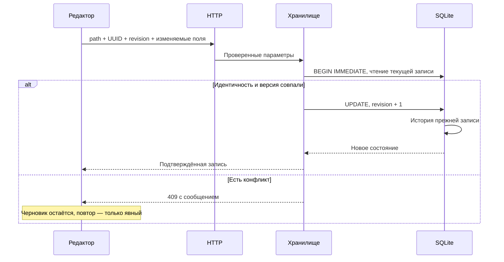

# Как проходят основные операции

Срез кода: **5 ноября 2026 года**. Сначала прочитай [устройство приложения](architecture.md). Здесь каждый сценарий связан с фактическими точками входа; подробные сигнатуры и вызовы — в [справочнике](reference/README.md).

## Открытие главной

1. Браузер получает `index.html`, CSS и локальные скрипты. `app.js` создаёт общий `state`, обработчики и переходы.
2. [showOrders](reference/javascript/static-app.md#symbol-showOrders) открывает главную, [loadOrders](reference/javascript/static-app.md#symbol-loadOrders) получает `/api/orders`.
3. [listed_orders](reference/python/server.md#symbol-listed_orders) читает зарегистрированные заказы, фильтрует неактивных клиентов и объекты, отделяет производство и архив, добавляет вложенные задачи, свободные события и планы платежей.
4. [OrderStore.record](reference/python/orders.md#symbol-OrderStore.record) преобразует SQL-строку: JSON-блоки, статусы, вычисляемые суммы, сроки, календарные признаки и роль пути.
5. [renderOrders](reference/javascript/static-app.md#symbol-renderOrders) строит группы таблицы; [renderHomeCalendar](reference/javascript/static-app.md#symbol-renderHomeCalendar) передаёт календарные данные в `HomeCalendar`.
6. Отдельные компоненты обновляют Telegram Inbox, файловый счётчик и сводку денег. Каждая подсистема имеет собственные ограничения и состояние ошибки.

Обычный опрос главной не обходит документы iCloud. Первоначальный импорт и обновление каталога задач работают отдельно. Ошибка файлового обхода не должна превращаться в удаление рабочих записей.

## Открытие папки

[navigate](reference/javascript/static-app.md#symbol-navigate) получает `/api/folder` и применяет представление по роли. [read_folder](reference/python/server.md#symbol-read_folder) проверяет путь и незавершённые переименования, определяет роль, собирает необходимые подпапки и разрешённые сведения о файлах.

У клиента — заметка и подпапки; у объекта — заметка, общий компонент списка его заказов и контейнеры; у самого заказа — карточка, задачи, события, счета, эскизы и файлы непосредственных `# cutter`/`# freza`, без автоматической загрузки остальных вложений. В событии или служебной папке доступны соответствующие документы. В сверке используется отдельное хранилище. Роль не определяется одной только глубиной пути: [классификатор](../folder_structure.py) учитывает служебные корни, числовые группы, годы и производство.

Дерево раскрывается лениво. Поиск дерева может потребовать обхода имён; это отдельная операция, а не скрытое действие опроса таблицы заказов.

## Файлы cutter и freza на странице заказа

[read_folder](reference/python/server.md#symbol-read_folder) выбирает только непосредственные `# cutter`/`# freza` настоящего заказа и обходит эти две ветки прежним безопасным списком файлов. Ответ `orderFileFolders` содержит существующие папки, `files` — их файлы с путями относительно заказа; `filesScope=events` сохраняет скрытый общий список и запрет загрузки в корень. [renderOrderFileFolders](reference/javascript/static-app.md#symbol-renderOrderFileFolders) выводит блоки после эскизов, сгруппированные карточки без массового выбора и переходы в папки. Файл использует прежний [showPreview](reference/javascript/static-app.md#symbol-showPreview), комментарии обновляют видимую карточку.

## Скачивание CDR на текущее устройство

[renderSketches](reference/javascript/static-app.md#symbol-renderSketches) и [fileCard](reference/javascript/static-app.md#symbol-fileCard) добавляют отдельную ссылку через [fileDownloadButton](reference/javascript/static-app.md#symbol-fileDownloadButton). Обычный GET `/api/file?path=…&download=1` проходит прежний `safe_path` и, на внешнем слушателе, проверку сессии; [send_file](reference/python/server.md#symbol-ManagerHandler.send_file) передаёт оригинальные байты с `Content-Disposition: attachment` и UTF-8-именем. Браузер сохраняет файл на своём устройстве. POST `/api/sketch-open` или `/api/open` при скачивании не отправляется. Нажатие превью/имени эскиза остаётся отдельным открытием CorelDRAW на M4; обновление актуальности сохраняет фокус ссылки скачивания.

## Сохранение карточки и конфликт

Название производственного статуса `done` — «Готово и оплачено». Интерфейс и новые текстовые карточки используют его; импорт прежнего «Готово» сохраняет тот же ключ. Переименование не выполняет запись в заказы и не меняет отдельный финансовый статус или суммы. На главной `done` по-прежнему скрыт, в объекте и «Скрытых заказах» доступен.

Основная форма: [saveCurrentStatus](reference/javascript/static-app.md#symbol-saveCurrentStatus) → `/api/order-save` → [OrderStore.save](reference/python/orders.md#symbol-OrderStore.save). Частичные кнопки используют отдельные маршруты и методы. Сохранение всей карточки ради переключения одного флажка опасно: старое поле формы могло бы затереть более новую задачу, сумму или событие.

Проверка revision — оптимистическая блокировка, а не автоматическое объединение текстов. После 409 форма остаётся у пользователя; серверные данные и черновик нужно сравнить. Фоновая перезагрузка не даёт права автоматически повторить запрос с новой revision.

## Создание заказа

[createOrderFolder](reference/javascript/static-app.md#symbol-createOrderFolder) отправляет заполненную форму. [create](reference/python/order_folders.md#symbol-create) проверяет клиентскую область, контейнер года и предлагаемое имя. [prepare](reference/python/order_creation.md#symbol-prepare) фиксирует намерение с UUID до завершения набора файловых действий.

Файловый план создаёт папку заказа и пустые `# bills`/`# cdr`; затем регистрация связывает путь и тот же UUID с записью SQLite. После сбоя [recover](reference/python/order_creation.md#symbol-recover) и [retry_one](reference/python/order_creation.md#symbol-retry_one) могут завершить только собственные шаги, владение которыми доказывается журналом. Похожее название чужой папки не считается доказательством.

Создание сверки использует этот механизм намерения, но создаёт только папку и запись сверки: заказные служебные подпапки и регистрация `orders` ей не нужны.

## Вложенные задачи

Собственные To-do находятся в блоке карточки; вложенные карточки — в `folder_notes`. [OrderTodos.refresh](reference/python/order_todos.md#symbol-OrderTodos.refresh) обновляет `todo_catalog`, фиксирует отсутствующие пути только после полного успешного обхода и сохраняет ошибки. [OrderTodos.attach](reference/python/order_todos.md#symbol-OrderTodos.attach) присоединяет готовую сводку к заказам без чтения файлов.

[OrderTodos.in_order](reference/python/order_todos.md#symbol-OrderTodos.in_order) возвращает задачи для страницы одного заказа. Выполненные сохраняются, но скрыты в обычной актуальной сводке. Обновление индекса не переносит задачи в родителя и не меняет их исходный текст.

## Закупка у поставщика

[SupplierPurchases.read](reference/python/supplier_purchases.md#symbol-SupplierPurchases.read) выбирает закупки из исходных заказов. У `etc` — только неназначенные строки; у поставщика — строки с соответствующим назначением. Выбор доступных кнопок опирается на сохранённые избранные разделы `# work`, при этом старые назначения не исчезают после снятия звезды.

Карандаш открывает [openEditor](reference/javascript/static-supplier-purchases.md#symbol-openEditor). Сохранение передаёт путь поставщика, путь/UUID/revision источника, индекс и исходный текст. [SupplierPurchases.edit](reference/python/supplier_purchases.md#symbol-SupplierPurchases.edit) проверяет принадлежность, а [write_purchase_text](reference/python/order_document.md#symbol-write_purchase_text) меняет только текст исходной строки с сохранением checkbox, назначений и переводов строк.

При изменении источника «Проверить изменения» перечитывает его без подмены черновика. Переставленная или исчезнувшая строка требует нового явного выбора; совпавший индекс не является идентичностью задачи.

## Три вида календарных записей

[renderWeekOrders](reference/javascript/static-home-calendar.md#symbol-renderWeekOrders) собирает через [orderGroups](reference/javascript/static-home-calendar.md#symbol-orderGroups) отдельные заголовки клиентов только для обычных заказов. Группы различаются точным путём, подписи содержат название и мелко объект. Поставщики идут выше всех групп заказчиков отдельными строками «поставщик · название» без заголовков; [renderCompactOrders](reference/javascript/static-home-calendar.md#symbol-renderCompactOrders) строит прежний плоский список синих ссылок. Заголовки и ссылки переиспользуются при опросе; восемь ячеек обычного заказа/поставщика остаются в его строке. В снимке после исключения закрытых строк истории удаляются и опустевшие заголовки по ключу группы следующей строки, включая соседство с отдельным поставщиком.

| Вид | Источник | Сохранение |
| --- | --- | --- |
| Событие заказа/поставщика | JSON-блоки `orders.extra_blocks` | Частичные методы `OrderStore` и преобразователи `order_calendar` |
| Свободное текстовое событие | `calendar_events` | `CalendarEvents` с UUID/revision и историей |
| План прихода/расхода | `invoices.data` | `InvoiceStore`, отдельные `_calendar_*` признаки |

[openCalendarEvent](reference/javascript/static-app.md#symbol-openCalendarEvent) и контекстное меню сначала определяют вид записи. Текстовый редактор заказа не должен сохранять план платежа через API свободного события. Выполнение, актуальность, выезд и «Смотри ту-ду» независимы; деньги и статусы заказа не меняются от календарной галочки.

У свободного события [openCalendarEvent](reference/javascript/static-app.md#symbol-openCalendarEvent) открывает и комментарий. [saveCalendarEvent](reference/javascript/static-app.md#symbol-saveCalendarEvent) отправляет оба поля через прежний POST; [CalendarEvents.save](reference/python/calendar_events.md#symbol-CalendarEvents.save) проверяет комментарий, UUID/revision, сохраняет название и комментарий с историей одной транзакцией. Отсутствующее поле старого клиента не очищает текст. [renderFreeEvents](reference/javascript/static-home-calendar.md#symbol-renderFreeEvents) добавляет значок облачка и `data-calendar-comment` к тому же DOM-узлу, убирает их после очистки. Общее [renderCalendarTodoPreview](reference/javascript/static-app.md#symbol-renderCalendarTodoPreview) читает комментарий из текущего `state.calendarEvents` и выводит его через `textContent` с переносами строк; окно использует прежние таймеры наведения, закрепление, Escape и удержание фокуса «Смотри ту-ду». Опрос обновляет открытый текст без сброса прокрутки; отсутствие комментария или исходного узла закрывает окно. Значок попадает в PNG, окно и полный текст — нет. Черновик обоих полей независим от опроса; после конфликта чтение новой версии показывает сохранённый комментарий и оставляет ввод формы.

[visibleOrderWeeks](reference/javascript/static-home-calendar.md#symbol-visibleOrderWeeks) оставляет строку прошедшей недели только при актуальном невыполненном событии. Неизвестные тексты сохраняют доступность. В текущей и будущих неделях действуют прежние правила сроков. «Мелкий заказ» показывает ссылку в первой колонке выбранной недели, сохраняя события, но убирая его обычную строку. Ручной перенос оплаты влево меняет размещение, а не дату платежа.

Семь кнопок под стрелками дневного контекстного меню вычисляются от даты выбранного события в UTC как контейнере гражданской даты. Смещение 1–7 передаётся одним запросом в прежний API переноса соответствующего вида записи; сервер сохраняет прежние проверки версии, занятой даты и остальных отметок. Недельным записям эти кнопки не показываются.

Для доходов/расходов пункт «Сообщил» вызывает `toggleCalendarEventFlag('notified')` → `/api/invoice-plan-calendar-notified` → `InvoiceStore.save_plan_calendar_notified`. Частичная транзакция проверяет UUID/revision и строгий boolean, пишет invoice_history и `_calendar_notified`, фиксирует контракт отката. `applyCalendarInvoicePlan` принимает подтверждённую версию; `renderInvoicePlans` показывает `calendar-notified` и доступную подпись «Сообщил». Неизвестный формат блокирует пункт, ошибка не повторяет запрос. Общий DOM-рендер и CSS сохраняют жёлтый фон в PNG, включая перенос слева и сочетание с серым текстом выполнения/неактуальности; отправка в Telegram сама отметку не включает.

`calendarRange` возвращает явный список ключей недель: текущая/будущие непрерывны, прошлые без открытых видимых дел пропускаются. Навигация и сохранение периода используют эти ключи, поэтому промежутки прошлого не возвращаются из-за более раннего открытого события. Переключатель «Старые» возвращает непрерывное прошлое и строки закрытых/снятых событий без изменения SQLite; опрос сохраняет режим.

Неделя определяется понедельником Москвы. JavaScript использует UTC-объект как контейнер гражданской даты; это не перенос делового дня в часовой пояс компьютера. [Подробный разбор дат](language/javascript.md).

## Общий PNG и `/calendar`

Кнопка использует [capture](reference/javascript/static-calendar-snapshot.md#symbol-capture), общий DOM-рендер и `/api/calendar-telegram`. Серверная команда работает без открытого пользовательского браузера: [send_calendar_command](reference/python/server.md#symbol-send_calendar_command) → [period](reference/python/calendar_delivery.md#symbol-period) → [render](reference/python/calendar_delivery.md#symbol-render) → WebKit → [send](reference/python/telegram_calendar.md#symbol-send).

Граница — воскресенье следующей недели Москвы. Предыдущая неделя добавляется только при видимом актуальном невыполненном событии заказа/поставщика, свободной записи или плане. Сроки и мелкие ссылки сами её не удерживают. Переключатель «Старые» влияет только на живую сетку; клон PNG отбрасывает добавленные просмотром истории закрытые строки заказов. Живая сетка показывает две недели; снимок может содержать три. Снимок и тексты [digest](reference/python/calendar_todos.md#symbol-digest) должны использовать один и тот же период и видимость.

Для команды [ingest](reference/python/telegram_inbox.md#symbol-ingest) в одной SQL-транзакции сохраняет запрос и getUpdates cursor. [enqueue](reference/python/telegram_calendar_commands.md#symbol-enqueue) связывает UUID с ботом, личным чатом и message_id; повтор доставки не создаёт новую отправку. [process](reference/python/telegram_calendar_commands.md#symbol-process) переводит `pending → sending → complete/failed`. Незавершённое `sending` после перезапуска автоматически не отправляется снова.

Одна `SEND_LOCK` сериализует кнопку и команду. Сначала подтверждённый `sendDocument`, затем части `sendMessage`. Каждый ответ проверяется; ошибка после PNG сообщает частичный результат. Идемпотентность приёма команды не равна гарантии exactly-once внешнего Bot API: после обрыва нельзя безопасно повторять неопределённый результат.

## Inbox Telegram и файловая папка Inbox

Это разные источники. [poll](reference/python/telegram_inbox.md#symbol-poll) принимает сообщения бота, [ingest](reference/python/telegram_inbox.md#symbol-ingest) делит допустимый человеческий текст по непустым строкам и фиксирует задачи с курсором без дублей. `/calendar` распознаётся отдельно в настроенном личном чате.

[snapshot](reference/python/inbox_folder.md#symbol-snapshot) только считает непосредственные видимые обычные файлы `#inbox`/`# inbox`, исключая ссылки. Неоднозначность и ошибка обозначают недоступность счётчика. Кнопка вызывает прежний `/api/open` с точным путём; файл не становится задачей Telegram и папка автоматически не создаётся.

## Счёт, выпуск, копия

[renderClientFilter](reference/javascript/static-bills.md#symbol-renderClientFilter) строит варианты клиентов по точному `client_path` всей сводки; [selectClient](reference/javascript/static-bills.md#symbol-selectClient) принимает выбор списка или нажатие имени в колонке. Клиент, поиск и сортировка применяются вместе в браузере; опрос и сохранение редактора обновляют строки без сброса фильтра, отсутствующий выбранный клиент остаётся выбранным.

[openFromCatalog](reference/javascript/static-invoices.md#symbol-openFromCatalog) открывает правку поверх общего списка по свежим данным `/api/invoice`. `edit_action=edit` ведёт в прежнее сохранение черновика, `copy` — в прежнее создание «На основе» с устойчивым UUID запроса и новым номером; выпущенный источник не заменяется. Сохранение, создание и выпуск отправляют `manager-invoice-saved` для обновления сводки с сохранением выбора и фокуса. Каталог вычисляет доступное действие из типа счёта и регистрации владельца, не читая PDF.

[InvoiceStore.catalog](reference/python/invoices.md#symbol-InvoiceStore.catalog) обслуживает общий список `# moneys/# bills` через GET `/api/invoice-catalog`: только сохранённые метаданные черновиков, выпущенных и прикреплённых счетов без планов и корзины. [refresh](reference/javascript/static-bills.md#symbol-refresh) обновляет таблицу с поиском каждые 5 секунд; [compareRecords](reference/javascript/static-bills.md#symbol-compareRecords) сохраняет выбранную сортировку по одной из шести колонок с датой первой и пустыми значениями в конце. Прежние ссылки открывают PDF из базы или исходный заказ. Вложенная `# inbox` использует непосредственный список файлов из [read_folder](reference/python/server.md#symbol-read_folder), без импорта и распределения.

[InvoiceStore.create](reference/python/invoices.md#symbol-InvoiceStore.create) создаёт черновик; `save` проверяет версию и данные, `issue` присваивает предусмотренный номер и фиксирует PDF. Байты выпущенного документа сохраняются в SQLite. Повторять выпуск как обычное обновление полей нельзя: для нового содержания создаётся документ «На основе».

Публикация в `# bills` повторяется по устойчивому состоянию. Имя существующего оригинала не занимается молча. Внешний PDF может загружаться как BLOB либо явно прикрепляться из `# bills` через [attach](reference/python/invoice_discovery.md#symbol-attach): отпечаток до/после чтения, предел размера, корректный PDF, защита от дубликата по точным байтам и устойчивой идентичности.

[upload](reference/python/invoice_documents.md#symbol-upload) обслуживает вложения счёта; это отдельные документы с собственной историей/публикацией, а не замена выпущенного PDF. План платежа в календаре не означает фактическое изменение `paid` заказа.

## Сверки

[Reconciliations.catalog](reference/python/reconciliations.md#symbol-Reconciliations.catalog) возвращает известные сверки для списка; явное `open` выполняет безопасный переход старых карточек. В `reconciliation_invoices` UUID счёта — первичный ключ, поэтому одновременно назначить его двум сверкам нельзя. `assign` проверяет актуальный контекст и меняет назначение, не удаляя счёт.

Переименование сохраняет UUID сверки, назначения и историю, но меняет путь/revision. Пустая заметка старого импорта считается безопасным исключением только при строгом наборе признаков; проверка находится в [untouched_empty_note](reference/python/reconciliations.md#symbol-untouched_empty_note).

## Переименование и корзина

Файловое действие не помещается целиком в SQL-транзакцию. Поэтому [Plan](reference/python/folder_layout.md#symbol-Plan) хранит план, отпечатки, журнал с flush/fsync и обратные операции; перенос не перезаписывает назначение. Специализированные rename-модули меняют связанные ключи SQLite, а незавершённый журнал блокирует обычные записи в затронутую область.

[resume](reference/python/file_trash.md#symbol-resume) умеет завершить доказанный подготовленный перенос. Самостоятельные `.restore.py` и копии модулей в журналах должны работать без текущего HTTP-сервера. Удалять такие «дубли» как неиспользуемые файлы нельзя. [restore](reference/python/event_trash.md#symbol-restore) дополнительно возвращает состояние папки события и её базовые связи.

## Просмотр документа

Просмотр оригинала начинается с проверки пути и типа. iCloud-чтение проходит через [read_bytes](reference/python/icloud_access.md#symbol-read_bytes), с пределом и таймаутом. PDFKit и ImageIO создают производные представления, оригинал не переписывается. Кеши привязаны к версии исходника.

Для Excel браузер запускает Worker: [open](reference/javascript/static-spreadsheet-preview.md#symbol-open) → `/api/spreadsheet` → `spreadsheet-worker.js` → локальный SheetJS → ограниченная порция ячеек. Макросы и формулы не выполняются. Сохранённые результаты формул можно показать; отсутствие результата не даёт права вычислять произвольный код книги.

## Резервная копия и релиз

Локальный `MetadataStore.backup` использует SQLite backup API и `quick_check`, затем публикует снимок. [create](reference/python/recovery_backup.md#symbol-create) собирает отдельный ZIP для iCloud: база, исходники, настройки, манифест и инструкция восстановления; не дублирует все вложения. Запись ZIP и его проверка не доказывают завершённую доставку iCloud на другое устройство.

[main](reference/python/scripts-deploy.md#symbol-main) фиксирует состав исходников, запускает тесты, проверяет неизменность состава, формирует пакет с хешами и отправляет его SSH-помощнику. [deploy](reference/python/scripts-deploy_remote.md#symbol-deploy) проверяет совместимость актуальной базы, готовит Swift-помощники и новый релиз, переключает код с контролем здоровья. База общая и не заменяется пакетом. Откат кода сохраняет текущие данные, но блокируется при неподдерживаемых контрактах.
